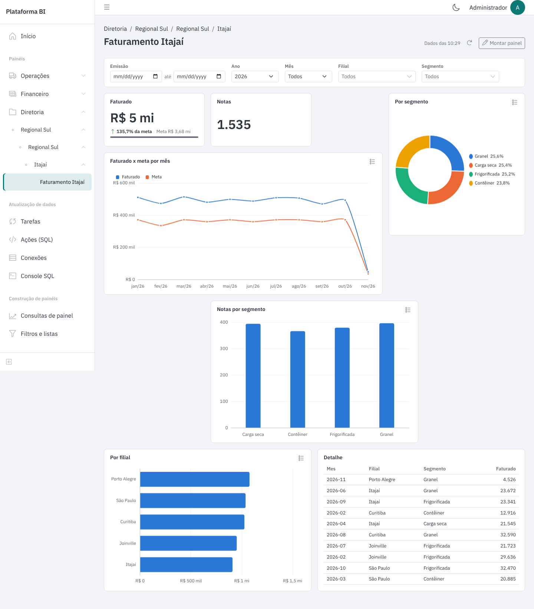
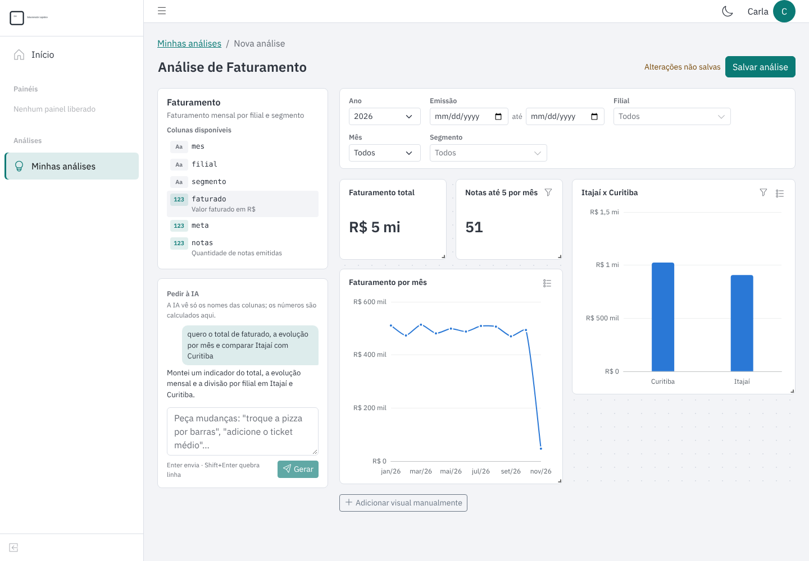

# Plataforma BI

Ferramenta web para publicar painéis de indicadores (estilo Power BI), com dados do SQL Server atualizados por tarefas agendadas, acesso por grupos de usuários e menu **Grupo › Subgrupo › Painel**.

Este pacote entrega as **Fases 0 a 5** do plano do projeto:

| Fase | Entrega |
| --- | --- |
| 0 | Estrutura do projeto e Docker |
| 1 | Login, aparência e tema claro/escuro |
| 2 | Usuários, grupos de acesso, menu e permissões |
| 3 | Perfis, e-mail obrigatório, subgrupos aninhados, conexões SQL Server, catálogo de ações e tarefas agendadas |
| 4 | Painéis com gráficos (Chart.js), montador em grade, filtros e Console SQL (com os ajustes de destaques, filtros por visual, aparência e tela cheia) |
| 5 | Login com Google e análises pessoais montadas com IA a partir de cubos |

| Camada | Tecnologia |
| --- | --- |
| Frontend | React 19 + Vite + TypeScript, CoreUI PRO 5, React Router, Chart.js 4, react-grid-layout, CodeMirror (editor de SQL) |
| Backend | Node.js 22 + TypeScript, Fastify 5, `pg`, `mssql`, Zod, `jose` (login Google) |
| IA | Claude (API da Anthropic), opcional |
| Bancos | PostgreSQL 16: `bi` (cadastros da ferramenta) e `bi_dados` (dados carregados pelas tarefas) |
| Origem dos dados | SQL Server (somente leitura) |
| Empacotamento | Docker + docker-compose (API, PostgreSQL e front em Nginx) |



---

## Perfis de acesso

| Perfil | Painéis | Análises com IA | Administração (usuários, grupos, menu, aparência) | Montar painéis | Tarefas | SQL: ações, conexões, consultas, filtros, cubos, Console |
| --- | --- | --- | --- | --- | --- | --- |
| **Usuário** | Os liberados para os seus grupos | Nos cubos liberados para os seus grupos | Não | Não | Não | Não |
| **Gestor** | Todos | Todos os cubos; vê o uso da IA | Sim | Sim, com as consultas prontas | Acompanha, executa, para, ativa/desativa | Não |
| **Desenvolvedor** | Todos | Todos os cubos | Sim | Sim | Tudo, incluindo agenda e parâmetros | Sim |

- O perfil é conferido no servidor a cada requisição, então uma mudança de perfil vale na hora.
- Somente um Desenvolvedor cria, altera, redefine a senha ou exclui contas de Desenvolvedor. Assim, um Gestor não consegue chegar ao SQL por um atalho.
- Sempre sobra pelo menos um Desenvolvedor ativo.

---

## O que já funciona

**Login e conta**
- Usuário e senha. Bloqueio de 15 min após 5 tentativas erradas e limite de 10 tentativas por minuto por IP.
- Sessão de 15 min renovada por cookie `httpOnly`. Recarregar a página mantém a sessão. Quanto tempo ela dura é definido por usuário (veja **Expiração da sessão**).
- No primeiro acesso, a troca de senha é obrigatória.
- **E-mail obrigatório.** Cadastros antigos sem e-mail informam o e-mail no próximo login, antes de usar o sistema.

**Aparência e tema:** nome, logo, imagem de fundo, cores, disposição do login, tema padrão e pré-visualização ao vivo. Cada pessoa escolhe tema claro ou escuro.

**Usuários, grupos e menu**
- Usuários com perfil, grupos de acesso, situação e último acesso. Redefinir senha gera uma senha temporária.
- **Expiração da sessão** (no cadastro do usuário, seção Sessão):
  - **Encerrar a sessão à meia-noite:** a sessão termina às 0h (fuso de `FUSO_AGENDA`, padrão Brasília), mesmo em uso.
  - **Encerrar após X horas sem uso** (1 a 720): a sessão termina depois desse tempo sem a pessoa clicar, digitar ou rolar a tela. Atualizações automáticas (painel em tela cheia, listas de tarefas e execuções, Console) não contam como uso.
  - As duas marcadas: vale a que acontecer primeiro.
  - **Nenhuma marcada: a sessão não expira**, indicado para as telas de torre de controle. A lista de usuários marca esses casos com "Sessão sem expirar".
  - Ao expirar, a pessoa volta para o login com o motivo ("encerrada à meia-noite" ou "por inatividade"). Quem garante é o servidor: o token de acesso nunca passa do fim da sessão.
  - Usuários que já existiam ficam com 168 horas (7 dias) sem uso, o mesmo comportamento de antes. Usuário novo começa com 8 horas sem uso.
- Grupos de acesso reúnem pessoas e os painéis liberados para elas.
- O menu tem Grupo › Subgrupo › Painel, com **até 3 níveis de subgrupo**. Mover um subgrupo leva junto tudo o que está dentro dele.
- O menu lateral e o Início mostram só o que cada pessoa pode ver. Abrir pela URL um painel não liberado é bloqueado no servidor.

**Atualização de dados**
- **Conexões:** SQL Server com senha criptografada (AES-256-GCM) e botão "Testar conexão". As mensagens de erro dizem se o problema é rede, login ou certificado.
- **Ações:** catálogo reaproveitável entre tarefas. Cada ação tem:
  - o SELECT executado na origem e o comando de limpeza executado no `bi_dados`;
  - a tabela de destino e o tempo máximo de execução.
- **Recursos do editor de ações:**
  - Destaque de sintaxe.
  - Conversão automática de `$[PARAM]` e `'$[PARAM]'` para `@PARAM`.
  - Botão **Validar colunas**: compara as colunas do SELECT com a tabela, sem executar a consulta.
  - Criação automática da tabela de destino na primeira carga, com os tipos convertidos do SQL Server.
- **Tarefas**
  - Grupos de tarefas e ações em ordem (10, 20, 30…).
  - Regra para quando uma ação dá erro (continuar ou parar a tarefa) e número de tentativas.
- **Agenda:** várias linhas por tarefa. Em cada linha, dias da semana *ou* dias do mês, meses, horas e minutos de 5 em 5, com atalhos como "Dias úteis", "Comercial (07h a 18h)" e "A cada 15 min".
- **Parâmetros:** valor padrão e valor diferente por linha de agenda. Podem ser fixos ou uma expressão calculada no SQL Server a cada execução (o antigo `EXEC=`). O botão "Calcular agora" mostra os valores sem carregar dados.
- **Execução**
  - Uma tarefa por vez, numa fila. Botões "Executar agora" e "Parar".
  - Histórico com o log completo de cada execução: parâmetros usados, linhas excluídas e inseridas por ação, duração e erros.
- **Regras de segurança da carga**
  - **Transação:** limpeza e carga acontecem juntas. Se algo falhar, nada muda na tabela, e os painéis nunca ficam com dados pela metade.
  - **Sem comando de limpeza,** a carga substitui todo o conteúdo da tabela, sem duplicar.
  - **Servidor sem resposta:** a ferramenta tenta de novo até o limite da tarefa (padrão: 5 vezes ou 15 minutos). Depois disso, registra no log qual servidor não respondeu.
  - **Tempo máximo estourado:** a ação é interrompida e o log registra "Tempo de execução excedido".
  - **Ferramenta fora do ar no horário agendado:** se ela voltar dentro do prazo, a tarefa roda com atraso. Fora do prazo, o log registra "Não executada".
  - **Disparo repetido:** se a tarefa ainda estiver na fila ou rodando no próximo horário, o novo disparo é ignorado e registrado.

**Painéis (Fase 4)**
- **Consultas de painel** (Desenvolvedor): SELECTs no `bi_dados` que alimentam os gráficos. O botão **Testar** roda a consulta com os valores iniciais dos filtros. Ao salvar, a ferramenta confere as colunas e os `@parâmetros`, e não deixa alterar uma consulta de forma que quebre um gráfico que já a usa.
- **Filtros e listas** (Desenvolvedor):
  - **Data (de/até):** gera `@NOME_INI` e `@NOME_FIM`.
  - **Ano** e **Mês:** listas prontas.
  - **Lista:** códigos cadastrados na própria ferramenta. Dá para colar duas colunas do Excel.
  - **Select:** código e descrição lidos de uma tabela do `bi_dados`.
  - Lista e Select permitem marcar vários. Cada filtro tem um valor inicial, como "Ano atual" ou "Mês anterior".
- **Montador** (Gestor e Desenvolvedor):
  - grade de 12 colunas: arrastar para mover, puxar o canto para redimensionar;
  - visuais: Indicador (com meta), Barras, Linhas, Pizza e Tabela, cada um com prévia ao vivo;
  - escolha dos filtros que aparecem no topo do painel.
- **Visualização**
  - Os filtros atualizam o painel sozinhos. Filtro em branco vale "todos".
  - Cada gráfico tem o botão **Ver dados em tabela**.
  - Cores validadas para daltonismo, nos temas claro e escuro.
  - No celular, os visuais ficam um embaixo do outro.
  - Cada consulta roda uma única vez por atualização, mesmo que vários gráficos a usem. O resultado fica em cache por 10 minutos e o cache é limpo quando uma tarefa carrega dados novos.
  - As consultas rodam somente leitura, com limite de 60 s e 20.000 linhas.

**Console SQL (Fase 4, só Desenvolvedor)**
- **No `bi_dados`:**
  - aceita consultas, INSERT, UPDATE, DELETE e DDL;
  - vários comandos separados por `;` rodam em sequência;
  - Ctrl+Enter executa;
  - a grade mostra até 1.000 linhas.
- **Transação:** clique em **Iniciar transação**, execute os comandos e depois **Confirmar** ou **Desfazer**. A transação é desfeita sozinha quando:
  - fica 10 minutos sem uso;
  - a pessoa sai da tela, fecha o navegador ou sai do sistema;
  - um comando dentro dela dá erro.
- **Conexões de origem (SQL Server):**
  - só um SELECT por vez;
  - executa numa transação que sempre é desfeita;
  - INSERT, UPDATE, DELETE, EXEC, SELECT INTO e afins são recusados.
- **Avisos e bloqueios**
  - Antes de DROP, TRUNCATE, DELETE, ALTER ou UPDATE numa tabela usada por uma ação ou por uma consulta de painel, a ferramenta mostra o aviso e pede confirmação.
  - Comandos de usuários, papéis, bancos, extensões, `SET ROLE` e `COPY ... PROGRAM` são bloqueados.
- **Usuário restrito:** o console usa o usuário `bi_dados_app`, que só alcança o `bi_dados`. Ele não consegue ler nem alterar o banco da ferramenta, onde ficam usuários, senhas e o log.
- **Histórico:**
  - registra usuário, data e hora, destino, comando, tipo, linhas, duração e erro;
  - mostra se a alteração foi gravada, confirmada ou desfeita;
  - tem filtros por usuário, tipo, destino, período e texto, e o botão **Abrir no editor**.
  - O log não pode ser alterado nem apagado, nem pelo dono do banco, porque há uma trigger que bloqueia isso.
- Na tela da ação, **Testar no console** abre o SELECT da ação na conexão de origem.

**Login com Google (Fase 5)**
- O botão "Fazer login com o Google" aparece na tela de login quando `GOOGLE_CLIENT_ID` está no `.env`. O login com usuário e senha continua.
- **Só entra quem já está cadastrado:** o e-mail da conta Google precisa ser o e-mail de um usuário ativo. Perfil e grupos continuam sendo definidos em Usuários.
- A API confere a assinatura do token com as chaves públicas do Google, o emissor, o ID do cliente, a validade e se o e-mail é verificado. Com `GOOGLE_DOMINIO`, aceita só contas do Google Workspace da empresa.
- Tentativas recusadas ficam na auditoria (`login_google_falhou`, com o motivo).

**Cubos e análises com IA (Fase 5)**
- **Cubo** (Construção de painéis › Cubos, só Desenvolvedor):
  - é a tabela que uma **ação** carrega no `bi_dados`, liberada para os usuários montarem as próprias análises. Não é preciso criar consulta nem painel;
  - os totais (soma, contagem, média, mínimo, máximo) e os filtros de cada visual são calculados dentro do banco, então ficam corretos mesmo em tabelas com centenas de milhares de linhas. A tabela de detalhe mostra até 1.000 linhas;
  - cubos criados antes, a partir de uma consulta de painel, continuam funcionando, e dá para trocar a origem para uma ação;
  - tem nome, descrição, uma explicação por coluna (ajuda a IA a escolher a coluna certa) e os grupos de acesso;
  - sem grupo, só Gestor e Desenvolvedor veem o cubo;
  - desativar esconde o cubo sem apagar as análises.
- **Minhas análises** (menu Análises, todos os perfis):
  1. Escolha o cubo. As colunas aparecem ao lado, com tipo e descrição; clicar numa coluna insere o nome dela no pedido.
  2. Descreva o que quer ver, por exemplo "faturamento por mês e comparar Itajaí com Curitiba". A IA monta indicadores, gráficos e tabelas, inclusive com filtros por visual.
  - **Começar a partir de um painel:** copia para a análise os visuais de um painel pronto que o usuário pode ver e que usa os mesmos dados do cubo (a mesma consulta ou, nos cubos de ação, as mesmas colunas). O painel original não muda. A IA também conhece a montagem desses painéis (sem os dados), então dá para pedir "igual ao painel X, mas por cliente".
  3. Peça ajustes na mesma conversa ("troque a pizza por barras", "adicione uma tabela por filial"). A IA mantém o que já existe, e os visuais que continuam ficam onde estavam.
  4. Arraste e redimensione os visuais, ajuste cada um pelo lápis (mesmo editor do montador) e use os filtros do topo.
  5. Salve. As análises são **pessoais**: cada usuário vê só as suas.
  - **Filtros no topo:** o botão **Filtros** cria filtros que valem para todos os visuais da análise: período, ano ou mês numa coluna de data, ou escolher valores numa coluna de texto ou número. As opções vêm dos próprios dados. A IA também cria esses filtros quando o pedido fala em filtro ("com filtro de mês e ano"). Os filtros de cada visual (funil no visual) continuam valendo para restrições fixas.
  - **Vários cubos na mesma análise:** o botão **+ Cubo** junta outro cubo liberado. Cada visual usa os dados de um cubo.
    - Cubos com uma coluna de mesmo nome e tipo (ex.: `cd_veiculo` em Manutenção e em Veículos) ficam **ligados automaticamente**. Colunas com cara de código (`cd_`, `id_`, `codigo`) têm preferência, e datas nunca ligam sozinhas.
    - Cada par de cubos tem no máximo uma ligação. Em **Ligações** dá para trocar a coluna, desligar ou ligar à mão colunas de nomes diferentes.
    - O filtro **atravessa a ligação**, como no Power BI: escolher o modelo "FH 540" (coluna de Veículos) filtra a Manutenção pelos `cd_veiculo` desses veículos, e um período de Manutenção filtra os Veículos que tiveram serviço no período. Funciona também em cadeia (A ligado a B ligado a C).
    - Visual de um cubo sem caminho até o cubo do filtro não é filtrado e mostra um aviso.
  - **Visualizar:** mostra só os gráficos, com os filtros no topo, tela cheia e atualização a cada 5 minutos em tela cheia. Na lista de Minhas análises, clicar na análise abre a visualização; **Editar** abre a montagem.
  - **Publicar como painel** (todos os perfis, na própria análise): coloca a análise no menu.
    - O local pode ser qualquer grupo ou subgrupo do menu a que a pessoa tem acesso, inclusive os vazios. Gestor e Desenvolvedor veem todos.
    - **Privado:** só quem publicou vê (e os Desenvolvedores, que não o veem no menu lateral, só pelo link ou pela lista de análises).
    - **Público:** todos com acesso àquele grupo/subgrupo do menu.
    - Quem vê o painel não precisa ter acesso aos cubos. O painel acompanha a análise: salvou a análise, o painel mudou. Para excluir a análise (ou um cubo que ela usa), tire o painel do menu antes.
  - **Desenvolvedor vê as análises de todos:** em Minhas análises aparece "Análises de outros usuários", que abrem em modo de leitura (só o dono altera).
- **O que vai para a IA ao montar análises:** só o pedido, o nome e a descrição dos cubos, as colunas (nome, tipo e descrição), as ligações entre os cubos e os nomes dos filtros do topo. **Nenhum dado do banco vai para a IA na montagem.** (O resumo da página inicial, se a pessoa escolher o modo IA, envia só números agregados; veja abaixo.) A IA devolve a configuração dos visuais e quem calcula os números é a própria ferramenta, com as mesmas regras e permissões dos painéis.
- **Proteções:**
  - tudo o que a IA devolve é validado: coluna inexistente, valor numérico em coluna de texto ou `exec=` são descartados, com aviso;
  - `exec=` não é aceito nas análises;
  - limite de pedidos por pessoa por dia (`IA_LIMITE_DIARIO`, padrão 50) e de 10 por minuto;
  - cada pedido fica registrado (usuário, cubo, texto, tokens e duração). A tela Cubos mostra o uso dos últimos 30 dias, para acompanhar o custo.
- Sem `ANTHROPIC_API_KEY`, as análises funcionam só no modo manual (Adicionar visual).

**Acesso por grupo e subgrupo do menu:** em Administração › Menu, cada grupo e subgrupo tem "Grupos com acesso". Vale para baixo (liberar o grupo do menu libera todos os subgrupos dele). Esse acesso define onde cada pessoa pode publicar análises e quem vê as análises publicadas como públicas. Os painéis montados continuam com o acesso por painel, como antes. Na atualização, cada subgrupo já começa liberado para os grupos que viam algum painel dentro dele.

**Falhas da IA:** quando a IA falha (chave recusada, modelo indisponível, sem créditos, sem conexão), o usuário vê a mensagem; Gestor e Desenvolvedor veem também a resposta técnica do serviço (ex.: `HTTP 401 · authentication_error: invalid x-api-key (request-id …)`), na conversa da análise e no resumo do Início. Em Cubos e uso da IA aparece a última falha de cada usuário. A chave nunca aparece nesses textos.

**Imagens e visual Imagem/logo:** em Atualização de dados › **Imagens** (Gestor e Desenvolvedor) fica a biblioteca de logos e figuras: incluir (vários arquivos de uma vez; o nome do arquivo vira o nome), renomear, trocar o arquivo e excluir. Aceita PNG, JPG, WEBP e GIF; SVG fica de fora por segurança. A biblioteca mostra onde cada imagem é usada e não deixa excluir uma imagem em uso.
- No montador de painéis e nas análises há o tipo de visual **Imagem/logo**: escolha a imagem e, se quiser, outra para o tema escuro (ex.: logo com letras brancas), o ajuste (caber inteira, preencher ou tamanho original), o alinhamento e se o título aparece.
- A imagem não consulta dados. Trocar o arquivo na biblioteca atualiza todos os visuais que usam a imagem.
- O arquivo é servido por um endereço com chave aleatória, sem login, para aparecer em telas de torre de controle. Não coloque na biblioteca imagens com informação sigilosa.

**Incluir visual existente:** ao montar um painel ou uma análise, o botão **Incluir existente** (ao lado de Adicionar visual) busca visuais que já existem pelo título, pelo nome do painel ou análise de origem, ou pela consulta/cubo, sem diferenciar acentos, com filtro por tipo. Ao escolher um item, a prévia aparece ao lado; dá para trocar o título antes de incluir.
- Entra uma **cópia**: ajustar a cópia não muda o original. Imagens continuam ligadas à biblioteca, então trocar o arquivo da logo atualiza todos os painéis que a usam.
- Nos painéis, a busca mostra os visuais de todos os painéis montados (Gestor e Desenvolvedor). Se a consulta do visual usa filtros que o painel ainda não tem, há a opção de incluí-los junto.
- Nas análises, a busca mostra os visuais das análises da própria pessoa, só de cubos que ela ainda pode usar. Se o cubo não estiver na análise, ele entra junto.
- Um visual com `exec=` pode ser copiado por um Gestor, desde que a expressão venha sem mudança (ela já foi escrita por um Desenvolvedor). Criar ou alterar `exec=` continua só para Desenvolvedor.

**Colunas calculadas:** no editor de visual (painéis e análises) há a seção **Colunas calculadas**, para criar valores com fórmulas sem mudar a consulta, a ação SQL ou criar tabela virtual. Vale só para aquele visual (até 10 por visual).
- Escrita como no Excel em português: colunas entre colchetes `[quantidade]`, textos entre aspas `"Pneus"`, `;` entre os argumentos e vírgula decimal. Contas `+ - * /`, comparações `= <> > < >= <=` e `E`, `OU`, `NAO`. Maiúsculas e acentos não importam nas comparações de texto. Clicar numa coluna ou função insere na fórmula, e a fórmula é conferida enquanto se digita.
- **Valor por grupo** (usa `SOMA`, `MEDIA`, `MINIMO`, `MAXIMO`, `CONTAR`, `CONTAR_DISTINTOS`, cada uma com condição opcional): calculado para cada barra, fatia, ponto ou indicador, depois dos filtros. Entra só como Valor. Exemplo, percentual do processo X no total do mês (com a categoria Mês e o formato Percentual): `SOMA([quantidade]; [processo] = "X") / SOMA([quantidade]) * 100`.
- **Por linha** (sem agregação, com `SE`, `ARRED`, `ABS`, `ANO`, `MES`, `DIA`, `SENULO`): vira uma coluna nova em cada linha e pode ser categoria, coluna da tabela, filtro do visual, destaque ou valor somado. Exemplo: `SE([valor] > 1000; "Alto"; "Baixo")`.
- Nos cubos de ação a fórmula vira SQL no próprio banco (os textos digitados vão como parâmetros, nunca como SQL); nos painéis de consulta o cálculo é feito na API. Divisão por zero dá vazio.

**Página inicial e Configurações:** o Início mostra um resumo dos painéis e análises que a pessoa mais abriu nos últimos 60 dias (até 4), calculados com os filtros iniciais de cada um. Em **Configurações** (menu do usuário, no alto) cada pessoa escolhe:
- **Números e variação:** o número de cada indicador e gráfico (total, último ponto da linha, maior categoria) com a variação desde o acesso anterior (o último dia em que viu o resumo);
- **Só o que mudou:** apenas os visuais cujo número mudou;
- **Resumo escrito pela IA:** um texto curto por painel. A IA recebe só os títulos, os totais e até 10 categorias de cada gráfico, nunca as linhas das tabelas. O texto é gerado uma vez por dia (o botão de atualizar gera de novo e conta no limite diário);
- **Desligado.**

**Auditoria:** registra logins, mudanças de cadastro (usuários, grupos, menu, conexões, ações, tarefas, agenda e parâmetros), execuções manuais e acessos a painéis.

---

## Rodar com Docker (servidor)

### Instalação nova

```bash
cp .env.example .env
# edite o .env: POSTGRES_PASSWORD, JWT_SECRET, CHAVE_CRIPTOGRAFIA, ADMIN_SENHA e ADMIN_EMAIL
docker compose up -d --build
```

Acesse `http://SERVIDOR:8080` e entre com `ADMIN_LOGIN` e `ADMIN_SENHA` do `.env`. O primeiro usuário é Desenvolvedor.

### Atualizando a partir de uma versão anterior da Fase 5

Extraia o pacote dentro da pasta `bi-platform` e rode `docker compose up -d --build api web`. As migrações `009_analises_varios_cubos.sql`, `010_expiracao_sessao.sql`, `011_acesso_menu_resumo.sql` e `012_imagens.sql` rodam sozinhas ao subir a API: as análises existentes continuam com o cubo delas e ganham os campos de vários cubos, filtros do topo e ligações; os usuários existentes ficam com sessão de 7 dias sem uso, como antes. A variável `REFRESH_TOKEN_DIAS` deixou de ser usada.

### Atualizando a partir da Fase 4

Extraia o pacote por cima da pasta, mantendo o `.env`, e rode `docker compose up -d --build`. A API aplica as migrações `005` a `007`.
- **Login com Google:** crie um ID do cliente OAuth do tipo "Aplicativo da Web" no Google Cloud Console (APIs e serviços › Credenciais). Em "Origens JavaScript autorizadas", inclua o endereço da ferramenta. Informe `GOOGLE_CLIENT_ID` no `.env` (e, se quiser, `GOOGLE_DOMINIO=ghlogistica.com.br`). O Google exige HTTPS, exceto em `http://localhost`.
- **IA:** crie uma chave em console.anthropic.com e informe `ANTHROPIC_API_KEY`. O servidor da API precisa acessar `https://api.anthropic.com` (porta 443).
- Depois de mudar o `.env`, rode `docker compose up -d` para a API ler os novos valores.

### Atualizando a partir da Fase 3

Extraia o pacote por cima da pasta, mantendo o `.env`, e rode `docker compose up -d --build`. Ao subir, a API:
- aplica a migração `004`;
- cria o usuário restrito `bi_dados_app`, que passa a ser o dono do `bi_dados` e das tabelas dele. A senha desse usuário é derivada da `CHAVE_CRIPTOGRAFIA`.

Nada no `.env` muda. **Não use** `docker compose down -v`: o `-v` apaga os volumes com os dados.

### Atualizando a partir da Fase 2

1. Guarde o `.env` atual e extraia este pacote por cima da pasta, ou numa pasta nova com o mesmo nome.
2. **Acrescente ao `.env`** a linha `CHAVE_CRIPTOGRAFIA=` com uma chave longa e aleatória, gerada com o mesmo comando do `JWT_SECRET`. Sem ela, a API não sobe e avisa qual variável falta.
3. Rode `docker compose up -d --build`.

Ao subir, a API faz três coisas sozinha:
- aplica a migração `003`;
- cria o banco `bi_dados`;
- converte os perfis: o primeiro administrador vira **Desenvolvedor** e os demais administradores viram **Gestor**.

Quem não tiver e-mail cadastrado informa o e-mail no próximo login.

| Serviço | O que é | Volume |
| --- | --- | --- |
| `web` | Nginx servindo o front e repassando `/api` e `/uploads` para a API | — |
| `api` | API Node.js e agendador das tarefas. Aplica as migrações ao iniciar | `uploads` |
| `db` | PostgreSQL 16, com os bancos `bi` e `bi_dados` | `db-data` |

**Backup:** guarde os volumes, ou faça o dump dos dois bancos, e o arquivo `.env`. A `CHAVE_CRIPTOGRAFIA` é necessária para ler as senhas das conexões.

```bash
docker compose exec db pg_dump -U bi bi > backup-bi.sql
docker compose exec db pg_dump -U bi bi_dados > backup-bi-dados.sql
```

Quando publicar atrás de HTTPS, mude `COOKIE_SECURE=true` no `.env`.

---

## Primeira tarefa, passo a passo

1. **Atualização de dados › Conexões › Nova conexão.** Exemplo: `ESCALA`, host `172.16.10.3`, porta `1433`, banco `ESCALASOFT`, usuário `bi_leitura`. Clique em **Testar conexão**.
2. **Ações › Nova ação.**
   - Cole o SELECT da ação da ferramenta atual. Os `$[PARAM]` viram `@PARAM` ao salvar.
   - Informe a tabela de destino, por exemplo `ghlogistico.etl_v_faturamento_cliente`.
   - Escreva o comando de limpeza, já em PostgreSQL, por exemplo `DELETE FROM ghlogistico.etl_v_faturamento_cliente WHERE anomes_referente BETWEEN @ANOMES_INI AND @ANOMES_FIM`.
   - Clique em **Validar colunas** para conferir.
3. **Tarefas › Grupos.** Crie os grupos (GERAL, ADM, ARMAZÉM, FROTA…).
4. **Tarefas › Nova tarefa.** Na tarefa:
   - **Ações:** adicione as ações na ordem e escolha a regra de erro de cada uma.
   - **Agenda:** crie as linhas de agenda.
   - **Parâmetros:** crie os parâmetros, por exemplo `@ANOMES_INI` como expressão `FORMAT(DATEADD(month, -3, GETDATE()), 'yyyyMM')`, e use **Calcular agora** para conferir.
5. Clique em **Executar agora** e acompanhe o log na aba **Execuções**.

Expressões da ferramenta antiga (Oracle) que precisam ser ajustadas para o SQL Server:

| Ferramenta atual (Oracle) | Nova (SQL Server) |
| --- | --- |
| `EXEC=TO_CHAR(SYSDATE,'YYYYMM')` | `FORMAT(GETDATE(), 'yyyyMM')` |
| `EXEC=TO_CHAR(ADD_MONTHS(SYSDATE, -3), 'YYYYMM')` | `FORMAT(DATEADD(month, -3, GETDATE()), 'yyyyMM')` |
| `EXEC=TRUNC(SYSDATE)` | `CAST(GETDATE() AS date)` |

---

## Primeiro painel, passo a passo

1. **Construção de painéis › Filtros e listas.** Crie os filtros. Exemplos:
   - `Ano` (tipo Ano, parâmetro `ANO`, valor inicial "Ano atual");
   - `Emissão` (Data, parâmetro `EMISSAO`);
   - `Filial` (Select na tabela `cadastros.filiais`, código `cd_filial`, descrição `nm_filial`, código numérico).
2. **Consultas de painel › Nova consulta.** Escreva o SELECT no `bi_dados`. Filtro em branco chega como `NULL`, que deve significar "todos":

   ```sql
   SELECT to_char(dt_emissao, 'YYYY-MM') AS mes, filial, SUM(vl_faturado) AS faturado
     FROM vendas.faturamento
    WHERE (@ANO IS NULL OR EXTRACT(YEAR FROM dt_emissao) = @ANO)
      AND (@EMISSAO_INI IS NULL OR dt_emissao >= @EMISSAO_INI)
      AND (@EMISSAO_FIM IS NULL OR dt_emissao <= @EMISSAO_FIM)
      AND (@FILIAIS IS NULL OR cd_filial = ANY(@FILIAIS))   -- seleção múltipla
    GROUP BY 1, 2
   ```

   Clique em **Testar** e depois salve.
3. **Administração › Menu e painéis.** Crie o painel e clique em **Montar**. Escolha os filtros do painel, adicione os visuais e salve.

Dica: deixe a consulta agrupar no nível mais detalhado que os gráficos precisam, como mês, filial e segmento. Cada visual soma, conta ou tira a média por cima disso, então uma consulta serve vários gráficos.

---

## Primeiro cubo, passo a passo

1. Confira se a tarefa da ação já rodou pelo menos uma vez, para a tabela existir no `bi_dados`. Nomes de coluna claros (`vl_frete`, `qtd_notas`, `filial`) ajudam a IA.
2. Em **Construção de painéis › Cubos**, crie o cubo:
   - escolha a ação. As colunas da tabela aparecem na hora;
   - descreva o cubo e as colunas principais, por exemplo "vl_liq: valor líquido em R$, sem impostos";
   - marque os grupos que podem usá-lo.
3. Peça a um usuário do grupo para abrir **Minhas análises › Nova análise** e testar alguns pedidos.



---

## Desenvolvimento local

Pré-requisitos: Node.js 22 e um PostgreSQL acessível. O usuário precisa poder criar o banco `bi_dados`, ou você aponta `BI_DADOS_URL` para um banco já existente.

```bash
cd backend && cp .env.example .env && npm install && npm run dev   # API: http://localhost:3333
cd frontend && npm install && npm run dev                          # Front: http://localhost:5173
```

---

## Estrutura

```
backend/
  migrations/              001 estrutura · 002 índices · 003 perfis, subgrupos e tarefas · 004 console e painéis
  src/
    db/                    Conexões com o banco da ferramenta e com o bi_dados, migrações
    lib/                   Autenticação e perfis, criptografia, parâmetros @nome no SQL
    origens/               Acesso às origens de dados (SQL Server; XLS e APIs depois)
    etl/                   Agenda, parâmetros, motor de execução e agendador (fila)
    paineis/               Filtros, execução das consultas (somente leitura, cache) e cálculo dos visuais
    routes/                auth, aparencia, usuarios, grupos, menu, conexoes, acoes, tarefas, console, catalogoPaineis, paineis, analises
    paineis/ia.ts          Pedido ao Claude (só colunas) e validação dos visuais devolvidos
    lib/google.ts          Validação do token do login com Google
frontend/
  src/
    pages/                 Login, troca de senha, e-mail, início, painel, Aparência
    pages/admin/           Usuários, Grupos de acesso, Menu e painéis
    pages/admin/           … e o Montador de painel
    pages/dados/           Tarefas (abas Execuções, Ações, Agenda, Parâmetros), Ações, Conexões, Console SQL
    pages/construcao/      Consultas de painel, Filtros e listas, Cubos
    pages/analises/        Minhas análises e a tela da análise (IA + grade)
    components/paineis/    Visual (indicador, Chart.js, tabela), grade e barra de filtros
docs/telas/                Capturas das telas
```

## API

| Método | Rota | Acesso |
| --- | --- | --- |
| POST | `/api/auth/login`, `/refresh`, `/logout` | público / cookie |
| GET | `/api/auth/me` | logado |
| POST | `/api/auth/trocar-senha`, `/completar-cadastro` | logado |
| GET | `/api/menu`, `/api/menu/paineis/:id` | logado (só o que pode ver) |
| * | `/api/usuarios`, `/api/grupos`, `/api/admin/menu/*`, `/api/aparencia` | Gestor e Desenvolvedor |
| GET | `/api/tarefas`, `/api/tarefas/:id`, `/:id/execucoes`, `/execucoes/:id`, `/fila` | Gestor e Desenvolvedor |
| POST / PATCH | `/api/tarefas/:id/executar`, `/:id/parar`, `/:id/ativa` | Gestor e Desenvolvedor |
| * | `/api/tarefas` (criar, editar, ações, agendas, parâmetros, grupos) | Desenvolvedor |
| * | `/api/conexoes`, `/api/acoes` (incluindo `/validar` e `/:id/criar-tabela`) | Desenvolvedor |
| GET / POST | `/api/paineis/:id/definicao`, `/:id/dados` | logado (só painéis que pode ver) |
| GET / PUT / POST | `/api/paineis/:id/montagem`, `/montagem/previa`, `/montagem/filtros` | Gestor e Desenvolvedor |
| GET | `/api/paineis/montagem/objetos` (busca de visuais para incluir) | Gestor e Desenvolvedor |
| POST | `/api/paineis/formula` (confere uma fórmula de coluna calculada; recebe só nomes e tipos das colunas) | logado |
| GET | `/api/catalogo/consultas`, `/filtros`, `/listas` | Gestor e Desenvolvedor (sem o SQL) |
| * | `/api/catalogo/*` (criar, editar, testar, excluir) | Desenvolvedor |
| * | `/api/console/*` (estado, executar, transação, log) | Desenvolvedor |
| GET / POST | `/api/auth/google/config`, `/api/auth/google` | público (o e-mail precisa estar cadastrado) |
| * | `/api/analises/*` (cubos, dados, ia, análises pessoais) | logado (cubos dos seus grupos; só as próprias análises) |
| GET | `/api/catalogo/cubos`, `/cubos/uso-ia` | Gestor e Desenvolvedor |
| * | `/api/catalogo/cubos` (criar, editar, excluir) | Desenvolvedor |
| GET | `/api/health` | público |

---

## Observações

- **Licença do CoreUI PRO:** o pacote instala pelo npm público, mas o uso exige licença comercial ativa.
- **Login do SQL Server:** use um login somente leitura (`bi_leitura`). A ferramenta só lê da origem.
- **Nomes de tabelas e colunas no `bi_dados`** ficam em minúsculas, porque é o padrão do PostgreSQL. Nos SQLs dos painéis, `ETL_V_X.CD_NUMERO` e `etl_v_x.cd_numero` funcionam igual.
- **Mensagens de erro do PostgreSQL** aparecem em inglês no Console, por exemplo `relation "x" does not exist`.
- **IA:** o custo depende do uso. Cada pedido gasta poucos milhares de tokens, porque nenhum dado é enviado. Acompanhe pela tela Cubos e ajuste `IA_LIMITE_DIARIO` se precisar.
- **Próximas etapas,** depois da validação da Fase 5:
  - importação de XLS e APIs;
  - exportação para PDF e imagem;
  - "Esqueci minha senha" por SMTP.
